# EduQuest - Backend

**Proyecto:** EduQuest — Plataforma educativa de materiales, grupos de estudio y planes inteligentes
**Curso:** CS 2031 Desarrollo Basado en Plataforma
**Entrega:** Semana 7 — Backend completo
**Integrantes:**

| Nombre | Código |
|---|---|
| Juan Pablo Saavedra Ruiz | 202510537 |
| Piero Alejandro Ortega Capacute | 202510580 |
| Omar Alonzo Guzmán Harvey | 202510519 |
| Edson Yenen Falcon Jimenez | 202510492 |

**Deployment:** desplegado — evidencias en la sección [Evidencias del Deploy](#evidencias-del-deploy).

---

## Índice

1. [Introducción](#introducción)
2. [Identificación del Problema o Necesidad](#identificación-del-problema-o-necesidad)
3. [Descripción de la Solución](#descripción-de-la-solución)
4. [Modelo de Entidades](#modelo-de-entidades)
5. [Decisiones de Diseño](#decisiones-de-diseño)
6. [Manejo de Errores](#manejo-de-errores)
7. [Medidas de Seguridad Implementadas](#medidas-de-seguridad-implementadas)
8. [Eventos y Asincronía](#eventos-y-asincronía)
9. [Instalación y Ejecución Local](#instalación-y-ejecución-local)
10. [Pruebas y Cobertura](#pruebas-y-cobertura)
11. [Variables de Entorno](#variables-de-entorno)
12. [Endpoints Documentados](#endpoints-documentados)
13. [Evidencias del Deploy](#evidencias-del-deploy)
14. [GitHub & Management](#github--management)
15. [Conclusión](#conclusión)
16. [Apéndices](#apéndices)

---

## Introducción

### Contexto

Los estudiantes universitarios y escolares carecen de una plataforma unificada que combine el acceso libre a materiales de estudio con entornos privados para asesorías académicas. Además, no cuentan con herramientas que les ayuden a planificar una metodología de estudio eficiente según la dificultad real de sus cursos. EduQuest nace para cerrar esa brecha: una única plataforma donde el estudiante encuentra recursos, comunidad y planificación inteligente.

### Objetivos del Proyecto

- Brindar un repositorio abierto de materiales de estudio (documentos) organizados y calificables por la comunidad.
- Permitir la creación de grupos privados de estudio donde se organicen sesiones de asesoría.
- Generar planes de estudio personalizados a partir de la percepción de dificultad de cada curso, apoyándose en una API de inteligencia artificial.
- Implementar un backend robusto: autenticación JWT, roles, manejo global de errores, eventos asíncronos y notificaciones por correo.

## Identificación del Problema o Necesidad

### Descripción del Problema

Los materiales de estudio están dispersos entre plataformas, páginas personales y servidores no oficiales; las asesorías se gestionan por canales informales (mensajería, correos); y la planificación del estudio se hace de forma empírica sin considerar la dificultad real de cada curso. Esta dispersión aumenta el tiempo que el estudiante pierde buscando recursos válidos y reduce la efectividad de su preparación.

### Justificación

Una plataforma que centralice materiales confiables, grupos privados de asesoría y un generador de planes de estudio resuelve tres dolores concretos: acceso a contenido validado por la comunidad (reseñas), acompañamiento académico organizado y una metodología de estudio adaptativa. Esto beneficia directamente el rendimiento académico y reduce la fricción de prepararse en solitario.

## Descripción de la Solución

### Funcionalidades Implementadas

- **Registro y autenticación de usuarios:** registro, login y renovación de tokens (access/refresh) con contraseñas cifradas con BCrypt.
- **Consulta del perfil propio:** endpoint protegido `/users/me` que expone los datos y roles del usuario autenticado.
- **Biblioteca de documentos:** subir y listar materiales académicos en la biblioteca abierta.
- **Grupos privados:** crear grupos de estudio y listar los existentes.
- **Sesiones de asesoría:** reservar y listar sesiones de estudio dentro de un grupo privado, con enlace de reunión, hora de inicio y hora de fin (máximo 8 horas).
- **Plan de estudio personalizado:** el usuario ingresa un curso y su dificultad percibida; el backend devuelve una metodología de estudio generada. Si el proveedor externo no está disponible (por ejemplo, sin créditos), se devuelve un plan base generado localmente para no interrumpir la experiencia.
- **Reseñas:** calificar y comentar documentos (1–5 estrellas) con validación de una reseña por usuario y por documento.
- **Administración de usuarios:** el rol ADMIN/MANAGER puede listar usuarios y el ADMIN puede cambiar roles.
- **Gestor (MANAGER) como moderador:** suspende estudiantes por 1, 3 o 7 días, envía advertencias, elimina materiales reportados, marca materiales como destacados y consulta un resumen de estadísticas de la plataforma. Solo el ADMIN puede vetar de forma permanente o suspender a otros gestores.
- **Perfil de asesor:** al registrarse o desde el perfil, el usuario puede marcarse como asesor; se muestra en miembros, sesiones, chat y ranking.
- **Biblioteca con curso y universidad:** cada material puede indicar su curso y su universidad o colegio, y la biblioteca filtra por ambos.
- **Favoritos:** guardar materiales en "Mis guardados".
- **Chat de grupo:** mensajes entre los miembros del grupo con historial paginado y actualización periódica desde los clientes. Los mensajes del grupo y los directos pueden incluir una imagen subida a la plataforma.
- **Asistencia y reseñas de asesorías:** confirmar asistencia antes de que empiece la sesión y registrar el ingreso real desde 10 minutos antes del inicio hasta el fin. Confirmar da 1 punto, asistir da 3 y quien confirmó pero no ingresó pierde 3. Al terminar, la sesión se califica de 1 a 5 estrellas (una vez por persona y no por quien la dictó).
- **Grabación de la asesoría:** quien la agendó puede adjuntar el video de YouTube; el backend valida que exista con oEmbed y guarda su título.
- **Plan de estudio del ciclo y progreso:** el plan puede incluir hasta 8 cursos con su dificultad; cada actividad del plan se puede marcar como hecha y el avance se guarda.
- **Logros y ranking:** puntos por aportar a la comunidad, siete insignias y ranking semanal e histórico.
- **Reportes y moderación:** cualquier usuario reporta materiales o usuarios; ADMIN/MANAGER revisan la bandeja, suspenden al usuario o eliminan el material reportado.
- **Notificaciones:** cada usuario recibe avisos cuando alguien se une a uno de sus grupos, comparte material o agenda una asesoría, cuando desbloquea una insignia y cuando le escriben por mensaje directo. El ADMIN puede enviar avisos a toda la comunidad o a una persona.
- **Gestión de grupos:** el creador edita el nombre y la descripción, quita integrantes o elimina el grupo (con su material, sesiones y chat); los demás miembros pueden salir del grupo.
- **Gestión de materiales:** quien subió un material (o el ADMIN) puede editarlo o eliminarlo.
- **Subida de archivos:** además de pegar un enlace, se puede subir el archivo (PDF, Office, texto o imagen, hasta 10 MB; videos MP4, WebM o MOV, hasta 50 MB); el backend lo guarda y devuelve una URL pública.
- **Mensajes directos:** conversaciones uno a uno entre usuarios, con contador de no leídos y búsqueda de personas por nombre de usuario.
- **Perfil público y seguidores:** cada usuario tiene un perfil con puntos, ranking, insignias ganadas y materiales públicos; se puede seguir a otras personas y recibir un aviso cuando comparten material.
- **Calendario personal:** las asesorías de todos los grupos del usuario en un rango de fechas.
- **Chat en tiempo real:** WebSocket en `/ws?token=<access token>` que envía al instante los mensajes nuevos, editados o eliminados y el aviso de «escribiendo…». Los mensajes se pueden responder (cita), editar y eliminar.
- **Foro por curso:** preguntas con búsqueda y filtros, respuestas, votos (útil / no útil) y mejor respuesta elegida por quien preguntó.
- **Apelaciones:** un usuario suspendido apela con su usuario y contraseña; ADMIN/MANAGER aceptan (levanta la suspensión) o rechazan, y se avisa por correo.
- **Verificación de correo:** al registrarse llega un código de 6 dígitos; hasta verificarlo la cuenta es de solo lectura (403 `EMAIL_NOT_VERIFIED`). Las cuentas creadas antes de esta función se consideran verificadas.
- **Límite de intentos de inicio de sesión:** tras 5 contraseñas incorrectas la cuenta se bloquea 15 minutos (429 `TOO_MANY_ATTEMPTS`).
- **Notificaciones push:** cada notificación también se envía al celular por Expo Push si el usuario registró su dispositivo.
- **Mensajes sin leer del chat de grupo:** cada grupo informa cuántos mensajes nuevos hay desde la última vez que el usuario abrió el chat.
- **Comunidad dentro de los grupos:** canales de texto (`#general` se crea solo), moderadores del grupo nombrados por el creador, menciones con `@usuario` que generan notificación, reacciones con emoji, mensajes fijados, hilos de respuesta, búsqueda en el historial, archivos de cualquier tipo permitido (PDF, Word, PowerPoint, Excel, texto) además de imágenes, encuestas, stickers (paquete animado de EduQuest y colección personal de hasta 30, que admite GIF animados), silenciar un grupo, miembros en línea y una sala de voz fija por grupo (Jitsi Meet). Los mensajes directos también aceptan archivos y stickers.
- **Lectura por canal:** cada canal informa cuántos mensajes y cuántas menciones `@usuario` tienes sin leer; las notificaciones de mención y de respuesta llevan al mensaje exacto (`?message=`) y el historial se puede cargar alrededor de un mensaje (`around`).
- **Moderación de canales:** canales de anuncios de solo lectura, modo lento de 0 a 3600 segundos y una lista de hasta 50 palabras prohibidas por grupo (se comparan sin tildes ni mayúsculas); los moderadores y el creador quedan exentos de las dos primeras reglas.
- **Mensajes guardados, fijados y estado:** guardar hasta 200 mensajes, fijar hasta 15 chats arriba y un estado personal (disponible, ocupado, ausente o invisible, con emoji y texto); quien está invisible no aparece en línea.
- **Chats grupales fuera de un grupo:** salas de 3 a 10 personas con mensajes, respuestas, adjuntos, lectura y notificación propia; la sala se elimina cuando sale la última persona.
- **Presencia en voz y sala de estudio:** quién entró a la sala de voz del grupo y un Pomodoro compartido (enfoque y descanso) que todos ven sincronizado con la hora del servidor; ambos se envían en tiempo real.
- **IA para estudiar:** resumen de lo que te perdiste en un canal y quiz o flashcards generados con Gemini a partir del PDF, texto o imagen de un material (se guardan en caché; si la IA falla se devuelve una versión básica).
- **Búsqueda global y calendario exportable:** un solo endpoint busca materiales, grupos, preguntas del foro y personas; el calendario personal se descarga como `.ics` para importarlo en Google Calendar.

### Tecnologías Utilizadas

- **Java 21 + Spring Boot 4.1.1** (Spring Web, Data JPA, Security, Validation, Mail).
- **PostgreSQL 18** (motor de base de datos, mediante Docker Compose en local).
- **JWT (jjwt 0.12.6)** para autenticación sin estado.
- **Lombok** para reducir código repetitivo en entidades y DTOs.
- **Thymeleaf** para plantillas HTML de correos.
- **API de Google Gemini (gemini-3.5-flash-lite)** para la generación de planes de estudio.
- **Docker / Docker Compose** para la base de datos local.

## Modelo de Entidades

### Diagrama

```
User ──< Document >──< Tag
User >──< Role
User ──< Review >── Document
User ──< StudyPlan
User >──< Document (saved_documents)
PrivateGroup ──< Document
PrivateGroup ──< StudySession
PrivateGroup ──< GroupMessage >── User
StudySession ──< SessionAttendance >── User
StudySession ──< SessionReview >── User
User ──< Report
```

### Descripción de Entidades

- **User:** estudiantes y asesores. Campos únicos para `username` y `email`; relación muchos-a-muchos con `Role`.
- **Role:** roles del sistema (enum `RoleName`: `ROLE_USER`, `ROLE_ADMIN`, `ROLE_MANAGER`) sembrados al arrancar.
- **Document:** material bibliográfico con autor (ManyToOne con `User`), etiquetas (ManyToMany con `Tag`) y, opcionalmente, el grupo privado donde se publicó (ManyToOne con `PrivateGroup`, `null` = documento global).
- **Tag:** etiquetas temáticas (por ejemplo "Matemática", "Física").
- **Review:** reseña de un documento (rating 1–5) con restricción única `(user_id, document_id)`.
- **StudyPlan:** plan de estudio generado por IA, asociado a un usuario (ManyToOne con `User`).
- **PrivateGroup:** grupo privado de estudio tipo servidor, con miembros (ManyToMany con `User`).
- **StudySession:** sesión de asesoría programada dentro de un grupo, con enlace de reunión y, opcionalmente, la grabación de YouTube.
- **SessionAttendance:** confirmación de asistencia de un usuario a una sesión (única por sesión y usuario).
- **SessionReview:** calificación de 1 a 5 de una asesoría terminada (única por sesión y usuario).
- **GroupMessage:** mensaje del chat de un grupo, con autor y fecha.
- **ChannelRead:** último mensaje leído por usuario y canal (para no leídos y menciones).
- **SavedMessage / PinnedChat:** mensajes guardados y chats fijados de cada usuario.
- **ChatRoom / RoomMessage / RoomVisit:** chats grupales fuera de un grupo, sus mensajes y la última lectura de cada integrante.
- **StudySet:** quiz o flashcards generados para un documento (caché por tipo).
- **Report:** reporte de un material o de un usuario, con motivo, estado (`OPEN`, `RESOLVED`, `DISMISSED`) y quién lo cerró.

Las relaciones usan `FetchType.LAZY` para las asociaciones de colección y `FetchType.EAGER` únicamente para los roles del usuario (cargados en cada autenticación). La colección dueña `Document.tags` usa `cascade = {PERSIST, MERGE}`: el cascade permite persistir y actualizar en cascada las etiquetas al crear o editar el agregado, mientras que los borrados y las asociaciones que referencian entidades ya existentes (roles y miembros de grupos) se gestionan explícitamente en el servicio.

## Decisiones de Diseño

### Arquitectura

```
Cliente (Postman / Frontend)
        │  HTTP/JSON · Authorization: Bearer <JWT>
        ▼
┌──────────────────────────── Spring Boot ────────────────────────────┐
│ Controller (solo HTTP + @Valid DTOs)                                │
│   → Service (interfaces, lógica de negocio)                         │
│       → Repository (JPA/Hibernate)                                  │
│   Eventos: @TransactionalEventListener(AFTER_COMMIT) + @Async       │
│     → EmailService (Thymeleaf HTML) / logs (SLF4J)                 │
│   Seguridad: JwtAuthorizationFilter → SecurityContext → @PreAuthorize│
└─────────────────────────────────────────────────────────────────────┘
        │                        │                          │
        ▼                        ▼                          ▼
   PostgreSQL 18 (JPA)    Gemini gemini-3.5-flash-lite (RestTemplate)    SMTP Gmail
```

- **Controller → Service → Repository:** los controladores solo orquestan HTTP y validan con `@Valid`; la lógica de negocio y las decisiones de autorización viven en los servicios detrás de interfaces, por lo que los controladores se mantienen delgados.
- **DTOs request/response separados:** nunca se exponen entidades al cliente; la contraseña no aparece en ninguna respuesta.
- **Inyección por constructor** en todos los beans y cumplimiento del principio de responsabilidad única.
- **ProblemDetail (RFC 9457)** como formato único de error con `timestamp`, `status`, `error`, `message`, `detail` y `path`, emitido por un `GlobalExceptionHandler` central.
- **HATEOAS considerado:** la API usa URIs REST por recurso (`/users`, `/documents`, `/reviews`) y está versionada en `/api/v1`; los enlaces hipermedia se dejan como evolución futura.
- **Configuración por perfiles:** `test` (H2 en memoria, integración continua) y `prod` (despliegue); el perfil por defecto usa PostgreSQL local mediante `.env`. Los secretos se inyectan con variables de entorno.

- **Paginación:** los endpoints de listado (`/documents`, `/groups`, `/admin/users`, `/documents/{id}/reviews`) aceptan `page` y `size` y responden una envoltura `{ content, page, size, totalElements, totalPages }`.

## Manejo de Errores

Todas las excepciones se centralizan en `GlobalExceptionHandler` (`@RestControllerAdvice`) y se devuelven como **ProblemDetail (RFC 9457)**, el estándar definido en el curso: `type`, `title`, `status`, `detail`, `instance`, `timestamp`, `path`, `error` y `message` (los últimos cuatro cubren a su vez el `ErrorResponseDTO` pedido por el enunciado). Ejemplos:

- 400 – validación (`MethodArgumentNotValidException`) con el mapa `errors` por campo y cuerpo mal formado.
- 401 – credenciales inválidas o token no provisto (via `AuthenticationEntryPoint`).
- 403 – acceso denegado por rol o por falta de permisos sobre el recurso.
- 404 – recurso no encontrado.
- 409 – conflicto (usuario o documento duplicado, reseña ya existente).
- 503 – servicio externo no disponible (por ejemplo, fallo al llamar al proveedor de planes de estudio).

Las excepciones personalizadas (`ResourceNotFoundException`, `DuplicateResourceException`, `InvalidCredentialsException`, `UnauthorizedException`, `ForbiddenException`, `InvalidOperationException`, `BadRequestException`, `ExternalServiceException`) permiten expresar la causa de negocio de cada error y mantener los controladores limpios.

## Medidas de Seguridad Implementadas

### Seguridad de Datos

- **JWT stateless:** `JwtService` genera tokens firmados con `Keys.hmacShaKeyFor(secret)` (secret en variable de entorno, mínimo 64 caracteres → HS512). El token incluye claims de `userId`, `email` y `roles`.
- **Access y refresh tokens:** los tokens de refresh se usan solo en `/auth/refresh`; el filtro rechaza usarlos en endpoints protegidos.
- **Contraseñas** cifradas con `BCryptPasswordEncoder`.
- **Autorización por roles:** `@PreAuthorize` en métodos sensibles. El `RoleInitializer` crea el usuario `admin` (email `admin@eduquest.com`) con la contraseña definida en `ADMIN_INITIAL_PASSWORD`; si la variable no está definida, no se crea ningún administrador.
- El filtro `JwtAuthorizationFilter` valida el header `Authorization: Bearer <token>` y carga el `UserPrincipal` en el `SecurityContext`.

### Prevención de Vulnerabilidades

- **Variables de entorno** para secretos (`JWT_SECRET`, credenciales de BD y de Gmail, `GEMINI_API_KEY`); `.env` y `.dockerignore` evitan subir credenciales al repositorio.
- **CSRF deshabilitado** solo por ser una API sin estado (no usa cookies de sesión).
- **Validación de entrada** en todos los DTOs (`@Valid`, `@Email`, `@NotBlank`, `@Size`, `@Pattern`).
- **Consultas por repositorio (JPA)** que previenen inyección SQL.
- **BCrypt con salt** evita el uso de tablas rainbow sobre contraseñas comprometidas.

## Eventos y Asincronía

El sistema publica eventos personalizados (`ApplicationEvent`) procesados de forma asíncrona con `@TransactionalEventListener(AFTER_COMMIT)` + `@Async`:

1. **`OnUserRegistrationEvent`:** tras el commit del registro, se envía un correo HTML de bienvenida usando plantillas Thymeleaf.
2. **`OnDocumentUploadedEvent`:** al subir un documento se notifica al autor por correo (tarea que no debe bloquear la respuesta HTTP).
3. **`OnStudyPlanGeneratedEvent`:** se registra el procesamiento del plan generado (logging automatizado).
4. **`OnGroupActivityEvent`:** un nuevo integrante, material o asesoría en un grupo genera una notificación para los demás miembros.
5. **`OnDirectMessageSentEvent`:** notifica al destinatario de un mensaje directo; los mensajes seguidos del mismo remitente se agrupan en una sola notificación mientras no se lea.
6. **`OnUserActivityEvent`:** tras aportar (material, reseña, asesoría, asistencia o avance del plan) se revisan las insignias y se notifica cada una nueva.

La asincronía está configurada con `@EnableAsync` y un `ThreadPoolTaskExecutor` con `threadNamePrefix = "EduQuestAsync-"`. Se usan transacciones (`@Transactional`) y el commit como punto de disparo para no enviar correos de operaciones que luego fallan. La comunicación por eventos desacopla publicación (`ApplicationEventPublisher`) y consumidor (`@EventListener`).

## Instalación y Ejecución Local

1. Levantar la base de datos: `docker compose up -d` (PostgreSQL en el puerto 5433).
2. Crear el archivo `.env` en la raíz (ver sección siguiente).
3. Ejecutar: `./mvnw spring-boot:run` (o desde IntelliJ con `EduquestBackendApplication`).
4. La API queda disponible en `http://localhost:8080/api/v1`.

## Pruebas y Cobertura

La suite de pruebas unitarias e integración alcanza un **~96% de cobertura (instrucciones)** con 471 pruebas, muy por encima del umbral mínimo de **80%** que exige la fase `verify`:

- **Unitarias** (Mockito + AssertJ): servicios (`Auth`, `Document`, `Group`, `Review`, `StudySession`, `StudyPlan`, `Admin`, `Gemini`, `Email`), seguridad (`JwtService`, `JwtAuthorizationFilter`, `UserDetailsServiceImpl`, `UserPrincipal`), eventos asíncronos, `RoleInitializer` y `GlobalExceptionHandler`.
- **Controladores** (8): verificación de respuestas HTTP y delegación al servicio (incluyendo autenticación vía `Authentication`/`UserPrincipal`).
- **Integración** (`AuthFlowIntegrationTest`, perfil `test` con H2): registro y login, perfil del usuario autenticado, protección de endpoints sin token, paginación real, subida de documentos a un grupo (403 si no eres miembro, 201 si sí) y gestión de roles (ADMIN cambia rol, MANAGER lista pero no cambia, USER no lista).
- **Medición**: JaCoCo genera el reporte en `target/site/jacoco/index.html` y falla el build si la cobertura baja del 80%.

Ejecutar con: `./mvnw verify`

## Variables de Entorno

`DB_HOST`, `DB_PORT`, `DB_NAME`, `DB_USER`, `DB_PASSWORD`, `DB_SSLMODE` (por defecto `prefer`; en RDS `require`), `STORAGE_PROVIDER` (`database` por defecto o `s3`), `S3_BUCKET`, `AWS_REGION`, `JWT_SECRET`, `JWT_EXPIRATION_ACCESS`, `JWT_EXPIRATION_REFRESH`, `MAIL_USER`, `MAIL_APP_PASSWORD`, `GEMINI_API_KEY`, `GEMINI_MODEL`, `ADMIN_INITIAL_PASSWORD`, `CORS_ALLOWED_ORIGINS`, `FRONTEND_URL` (dirección de la web que se usa en el enlace del correo para recuperar la contraseña; por defecto `http://localhost:5173`). Todas se cargan en `application.properties` mediante `spring.config.import=optional:file:./.env[.properties]` y, en producción, son provistas por la plataforma de despliegue.


## Endpoints Documentados

- `POST /api/v1/auth/register` — registro (público).
- `POST /api/v1/auth/login` — login (público).
- `POST /api/v1/auth/refresh` — renovar access token.
- `POST /api/v1/auth/forgot-password` con `{ "email": "..." }` — envía por correo un código de 6 dígitos (vence en 15 minutos) y un enlace a la web. Responde 202 aunque el correo no exista, para no revelar qué cuentas hay.
- `POST /api/v1/auth/reset-password` con `{ "email", "code", "password" }` — cambia la contraseña con el código (máximo 5 intentos por código; 400 si no es válido o venció).
- `GET /api/v1/users/me` — perfil del usuario autenticado (incluye `avatarUrl`).
- `PATCH /api/v1/users/me/password` con `{ "currentPassword", "newPassword" }` — cambiar la contraseña desde el perfil (400 si la actual no coincide).
- `PATCH /api/v1/users/me` — cambiar el nombre de usuario; devuelve tokens nuevos porque el nombre es el `subject` del JWT (409 si ya existe).
- `PUT /api/v1/users/me/avatar` — subir foto de perfil (`multipart/form-data`, campo `file`, JPG/PNG/WEBP hasta 2 MB).
- `DELETE /api/v1/users/me/avatar` — quitar la foto de perfil.
- `GET /api/v1/users/{id}/avatar` — imagen de perfil (pública, con caché de 7 días).
- `GET /api/v1/admin/users?page=0&size=10` y `GET /api/v1/admin/users/{id}` — ADMIN/MANAGER (listado paginado).
- `PATCH /api/v1/admin/users/{id}/role?role=ROLE_MANAGER` — solo ADMIN.
- `POST /api/v1/admin/users/{id}/warning` con `{ "message": "..." }` — ADMIN/MANAGER. Envía una advertencia que llega como notificación.
- `GET /api/v1/admin/stats` — ADMIN/MANAGER. Usuarios, nuevos de la semana, suspendidos, materiales, grupos, asesorías de la semana y reportes abiertos.
- `PATCH /api/v1/admin/users/{id}/ban` con `{ "reason": "...", "days": 3 }` y `PATCH /api/v1/admin/users/{id}/unban` — ADMIN/MANAGER. Sin `days` el veto es permanente (solo ADMIN); el MANAGER solo suspende estudiantes hasta 7 días. No se puede vetar a sí mismo ni a otro ADMIN. Un usuario vetado recibe **403** con `code: "USER_BANNED"`, `banReason`, `bannedAt` y `bannedUntil` al iniciar sesión, al registrarse con el mismo correo o usuario, al renovar el token y en cualquier petición con un token anterior.
- `GET /api/v1/documents?page=0&size=10&search=&tag=&course=&university=&sort=recent` (paginado; `sort` admite `recent`, `oldest` o `title`), `POST /api/v1/documents` — listar / crear documentos (con `course` y `university` opcionales).
- `GET /api/v1/documents/saved`, `GET /api/v1/documents/saved/ids`, `POST|DELETE /api/v1/documents/{documentId}/saved` — materiales guardados.
- `POST /api/v1/groups`, `GET /api/v1/groups?page=0&size=10`, `GET /api/v1/groups/{groupId}` — grupos (listado paginado y detalle). Al crear se envía `visibility` (`PUBLIC` por defecto o `PRIVATE`); los privados exigen `password` (4-50 caracteres, se guarda con BCrypt). Cada grupo recibe un código único de 6 caracteres. El listado muestra los públicos y los privados a los que ya perteneces; un privado no es visible por id para quien no es miembro.
- `GET /api/v1/groups?search=` — el listado admite `search` para filtrar por nombre (públicos y los privados donde ya eres miembro; un privado ajeno solo se encuentra por código).
- `GET /api/v1/groups/mine` — tus grupos ordenados por última actividad (nuevo documento o sesión), con `unreadDocuments`, `unreadSessions` y `unreadCount` desde tu última visita. `POST /api/v1/groups/{groupId}/seen` marca el grupo como visto (204).
- `GET /api/v1/groups/code/{code}` — busca un grupo público o privado por su código (sin distinguir mayúsculas). 404 si no existe.
- `POST /api/v1/groups/{groupId}/join` — unirse. En grupos privados se envía `{ "password": "..." }` o `{ "inviteToken": "..." }`; 403 si no son válidos y 409 si ya eres miembro.
- `POST /api/v1/groups/{groupId}/invite?regenerate=false` — solo el creador. Devuelve `{ code, token, expiresAt }`: un enlace de invitación que vale 7 días y deja entrar sin contraseña. Con `regenerate=true` crea uno nuevo e invalida el anterior.
- `PUT /api/v1/groups/{groupId}/password` con `{ "password": "..." }` — solo el creador de un grupo privado. Como la contraseña se guarda con BCrypt no se puede consultar; si el creador la olvida, pone una nueva.
- `POST /api/v1/groups/{groupId}/documents` — subir un documento al grupo. **Solo si el usuario es miembro** de ese grupo (403 en caso contrario).
- `POST|GET /api/v1/groups/{groupId}/sessions` — sesiones de asesoría. El enlace de la reunión (`meetingUrl`) es obligatorio y debe empezar con `http://` o `https://`; `endsAt` es opcional (por defecto una hora después del inicio). La respuesta incluye `started`, `checkInOpen`, `checkedIn`, `attendeeCount` (confirmados) y `checkedInCount` (asistieron). Cada sesión indica quién la agendó (`createdByUsername`) y si el usuario actual puede gestionarla (`canManage`).
- `PUT|DELETE /api/v1/groups/{groupId}/sessions/{sessionId}` — editar (título, descripción, fecha o enlace) o eliminar una sesión. Solo quien la agendó o el creador del grupo; 403 en otro caso.
- `POST|DELETE /api/v1/groups/{groupId}/sessions/{sessionId}/attendance` — confirmar o cancelar asistencia (400 si la sesión ya empezó).
- `POST /api/v1/groups/{groupId}/sessions/{sessionId}/check-in` — registra que el usuario ingresó a la reunión (400 fuera del horario).
- `GET|POST /api/v1/groups/{groupId}/sessions/{sessionId}/reviews` — reseñas de la asesoría. Solo después de que termine, una por persona y no por quien la agendó (409 si ya calificaste).
- `PUT /api/v1/groups/{groupId}/sessions/{sessionId}/recording` con `{ "recordingUrl": "https://youtu.be/..." }` — adjunta o quita (vacío) la grabación. Se valida con YouTube oEmbed.
- `GET /api/v1/groups/{groupId}/messages?after=&before=` y `POST /api/v1/groups/{groupId}/messages` — chat del grupo (solo miembros). Sin parámetros devuelve los últimos 50; `after` trae los nuevos y `before` el historial. El cuerpo acepta `content` y/o `imageUrl` (URL de `/api/v1/files` con imagen PNG, JPG o WEBP).
- `PUT /api/v1/groups/{groupId}`, `DELETE /api/v1/groups/{groupId}`, `POST /api/v1/groups/{groupId}/leave` y `DELETE /api/v1/groups/{groupId}/members/{memberId}` — editar, eliminar o salir de un grupo y quitar integrantes.
- `PUT /api/v1/documents/{documentId}` y `DELETE /api/v1/documents/{documentId}` — editar o eliminar tu material.
- `POST /api/v1/files` (multipart, campo `file`) y `GET /api/v1/files/{id}/{nombre}?download=` — subir un archivo y descargarlo (público).
- `DELETE /api/v1/study-plans/{planId}` — eliminar un plan de estudio.
- `POST /api/v1/groups/{groupId}/messages/seen` — marca el chat del grupo como leído; `GET /api/v1/groups/mine` incluye `unreadMessages`.
- `GET /api/v1/notifications?page=0&size=15`, `GET /api/v1/notifications/unread-count`, `PATCH /api/v1/notifications/{id}/read` y `PATCH /api/v1/notifications/read-all` — campana de notificaciones.
- `GET /api/v1/conversations`, `GET /api/v1/conversations/unread-count`, `GET /api/v1/conversations/contacts?search=` y `GET /api/v1/conversations/contacts/{userId}` — bandeja de mensajes directos y búsqueda de personas.
- `GET /api/v1/conversations/{userId}/messages?after=&before=`, `POST /api/v1/conversations/{userId}/messages` y `POST /api/v1/conversations/{userId}/read` — conversación con una persona.
- `POST /api/v1/admin/notifications` con `{ "title": "...", "message": "...", "username": "opcional" }` — aviso del ADMIN a todos o a un usuario.
- `POST /api/v1/study-plans/generate` — plan de estudio personalizado: `courseName` y `difficulty` para un curso, o `courses` (lista de `{ name, difficulty }`, hasta 8) para todo el ciclo.
- `GET /api/v1/study-plans` y `PUT /api/v1/study-plans/{planId}/progress` con `{ "completedSteps": [0, 2] }` — historial con `totalSteps` y `completedSteps`, y guardado del avance.
- `GET /api/v1/users/{id}/profile`, `GET /api/v1/users/{id}/documents`, `POST|DELETE /api/v1/users/{id}/follow`, `GET /api/v1/users/me/following` — perfil público y seguidores.
- `GET /api/v1/sessions/mine?from=2026-11-01&to=2026-12-01` — calendario con las asesorías de mis grupos (máximo 62 días).
- `PUT|DELETE /api/v1/groups/{groupId}/messages/{messageId}` y `PUT|DELETE /api/v1/conversations/{userId}/messages/{messageId}` — editar o eliminar mensajes; al enviar se puede indicar `replyToId`.
- `GET|POST /api/v1/groups/{groupId}/channels`, `PUT|DELETE /api/v1/groups/{groupId}/channels/{channelId}` — canales (crear, editar y borrar: creador o moderador).
- `GET /api/v1/groups/{groupId}/messages?channelId=&after=&before=`, `GET …/messages/search?q=&channelId=`, `GET …/messages/pins?channelId=`, `GET …/messages/{messageId}/thread`, `POST …/messages/{messageId}/reactions` con `{ "emoji": "👍" }`, `PUT …/messages/{messageId}/pin?pinned=true` — chat por canal, búsqueda, fijados, hilos y reacciones. Al enviar se puede indicar `channelId`, `threadRootId`, `fileUrl`, `fileName` y `sticker`.
- `POST /api/v1/groups/{groupId}/polls` y `POST /api/v1/groups/{groupId}/polls/{pollId}/vote` con `{ "optionId": 3 }` (o `null` para retirar el voto) — encuestas.
- `PUT /api/v1/groups/{groupId}/members/{memberId}/moderator?moderator=true`, `PUT /api/v1/groups/{groupId}/mute?muted=true`, `GET /api/v1/groups/{groupId}/voice-room`, `GET /api/v1/groups/{groupId}/online` — moderadores, silenciar, sala de voz y presencia.
- `GET|POST /api/v1/users/me/stickers`, `DELETE /api/v1/users/me/stickers/{id}` — stickers personales.
- `GET|POST /api/v1/forum/questions`, `GET|DELETE /api/v1/forum/questions/{id}`, `POST /api/v1/forum/questions/{id}/answers`, `POST /api/v1/forum/questions/{id}/answers/{answerId}/accept`, `POST /api/v1/forum/answers/{id}/vote`, `DELETE /api/v1/forum/answers/{id}` — foro.
- `POST /api/v1/auth/appeals` (público), `GET /api/v1/admin/appeals?status=PENDING`, `GET /api/v1/admin/appeals/pending-count`, `PATCH /api/v1/admin/appeals/{id}` — apelaciones.
- `POST /api/v1/users/me/verify-email` con `{ "code": "123456" }` y `POST /api/v1/users/me/verify-email/resend` — verificación de correo.
- `POST|DELETE /api/v1/users/me/push-tokens` con `{ "token": "ExponentPushToken[...]" }` — registrar el celular para push.
- `POST /api/v1/groups/{groupId}/channels/{channelId}/read`, `GET|PUT /api/v1/groups/{groupId}/moderation` con `{ "bannedWords": [...] }` — no leídos por canal y palabras prohibidas.
- `GET /api/v1/groups/{groupId}/voice`, `POST …/voice/join`, `POST …/voice/leave` — quién está en la sala de voz.
- `GET /api/v1/groups/{groupId}/study-room`, `POST …/study-room/start` con `{ "focusMinutes": 25, "breakMinutes": 5 }`, `POST …/study-room/join|leave|stop` — sala de estudio compartida.
- `GET /api/v1/groups/{groupId}/messages/summary?channelId=` — resumen con IA de lo último del canal; `GET …/messages?channelId=&around=` — historial alrededor de un mensaje.
- `PUT /api/v1/groups/{groupId}/messages/{messageId}/saved?saved=true` y `GET /api/v1/users/me/saved-messages` — mensajes guardados.
- `PUT /api/v1/users/me/status`, `GET /api/v1/users/statuses?ids=1,2`, `GET|PUT /api/v1/users/me/pinned-chats` — estado personalizado y chats fijados.
- `GET|POST /api/v1/rooms`, `GET|PATCH /api/v1/rooms/{roomId}`, `POST …/leave`, `GET|POST …/messages`, `PUT|DELETE …/messages/{messageId}`, `POST …/read` — chats grupales.
- `POST /api/v1/documents/{documentId}/study-set?type=QUIZ|FLASHCARDS&refresh=false` — quiz o flashcards con IA.
- `GET /api/v1/search?q=` — búsqueda global; `GET /api/v1/sessions/mine/calendar.ics` — exportar el calendario.
- `GET /api/v1/gamification/me` y `GET /api/v1/gamification/leaderboard?period=week|all` — puntos, insignias y ranking.
- `POST /api/v1/reports` con `{ "targetType": "DOCUMENT|USER", "targetId": 1, "reason": "..." }` — reportar contenido.
- `GET /api/v1/admin/reports?status=OPEN`, `GET /api/v1/admin/reports/open-count`, `PATCH /api/v1/admin/reports/{id}` con `{ "status": "RESOLVED|DISMISSED" }` — bandeja de moderación (ADMIN/MANAGER).
- `DELETE /api/v1/admin/documents/{documentId}` — eliminar un material reportado junto con sus reseñas (ADMIN/MANAGER).
- `PATCH /api/v1/admin/documents/{documentId}/featured?featured=true` (ADMIN/MANAGER) y `GET /api/v1/documents/featured` — materiales destacados de la biblioteca pública.
- `POST /api/v1/reviews`, `GET /api/v1/reviews/{id}`, `DELETE /api/v1/reviews/{id}` y `GET /api/v1/documents/{documentId}/reviews?page=0&size=10` — reseñas (listado paginado).

La colección completa con ejemplos está en el archivo `postman_collection.json` en la raíz del repositorio.

### Documentación interactiva (Swagger UI)

La API incluye **Swagger UI / OpenAPI 3.1** (springdoc-openapi v3), disponible en:

- `http://localhost:8080/swagger-ui.html` (o `/swagger-ui/index.html`) — interfaz interactiva para probar cada endpoint.
- `http://localhost:8080/v3/api-docs` — spec OpenAPI en JSON.

Para probar los endpoints protegidos, primero genera un token en `POST /api/v1/auth/login` y usa el botón **Authorize** de Swagger pegando el `accessToken` (se envía como `Authorization: Bearer <token>`). El esquema de seguridad se define en `config/OpenAPIConfig.java` y los controladores están documentados con `@Tag`/`@Operation`.

## Despliegue en AWS (EC2 + RDS + S3)

Arquitectura: el backend corre con Docker Compose en un **EC2** detrás de [Caddy](https://caddyserver.com) (HTTPS automático con Let's Encrypt y `wss://` para el WebSocket), la base de datos está en **RDS PostgreSQL**, los archivos (materiales, imágenes, videos, fotos de grupos y de perfil) se guardan en un bucket **S3** privado y la web se publica en **AWS Amplify**. La imagen del backend la construye y publica en Docker Hub el workflow `docker-publish.yml` en cada push.

**Archivos.** Con `STORAGE_PROVIDER=s3` el backend sube cada archivo a S3 y en la base solo guarda sus datos y la clave del objeto. Las URLs que reciben la web y la app siguen siendo `https://<API_DOMAIN>/api/v1/files/{id}/{nombre}`: al pedirlas, el backend responde con una redirección a una URL firmada de S3 que dura 10 minutos, así el bucket nunca es público. En local, sin esa variable, todo sigue guardándose en PostgreSQL.

1. **S3 e IAM.** En CloudFormation crea un stack con `deploy/cloudformation.yml`. El stack crea el bucket (privado, cifrado, solo HTTPS y con CORS de lectura, porque al seguir la redirección el navegador envía `Origin: null`; los objetos solo se leen con la URL firmada) y el rol `eduquest-backend-<región>` con permiso solo para subir, leer y borrar en ese bucket. Anota las salidas `BucketName` y `Region`. En AWS Academy, que no permite crear roles, usa `CreateInstanceRole=false` y en el paso 2 asigna `LabInstanceProfile`.
2. **EC2.** Lanza una instancia Amazon Linux 2023 (t3.small recomendada) con una IP elástica y asígnale el perfil de instancia del paso 1. En *Security Group*: puertos **80** y **443** abiertos y **22** solo desde tu IP. Deja *Metadata response hop limit* en **2** para que el contenedor pueda leer las credenciales del rol.
3. **RDS.** Crea una base PostgreSQL sin acceso público y con nombre inicial `eduquest`. Su *Security Group* debe permitir el puerto **5432** solo desde el *Security Group* del EC2. Las tablas se crean al arrancar el backend.
4. **Dominio.** Apunta un dominio a la IP elástica del EC2 o usa `<ip-con-guiones>.sslip.io` (por ejemplo `3-85-10-20.sslip.io`), que resuelve a esa IP sin configurar nada. Amplify sirve la web por HTTPS, así que el backend también necesita HTTPS.
5. **Arranque.** En el EC2: `git clone` del repositorio, `bash deploy/setup-ec2.sh`, vuelve a entrar por SSH y luego `cd deploy && cp .env.example .env`. Completa el `.env` (endpoint de RDS en `DB_HOST`, `S3_BUCKET`, `AWS_REGION`, `API_DOMAIN`, la URL de Amplify en `CORS_ALLOWED_ORIGINS` y `FRONTEND_URL`, y los secretos) y ejecuta `docker compose -f docker-compose.prod.yml up -d --build` (construye la imagen en el EC2; si usan la de Docker Hub, `pull` en lugar de `--build`).
6. **CORS.** `CORS_ALLOWED_ORIGINS` se aplica a la API, al WebSocket y a las vistas previas en iframe. Debe ser la URL exacta de Amplify, sin barra final; si luego usan un dominio propio se agrega separado por comas. La app móvil no envía cabecera `Origin`, así que no necesita estar en la lista.
En **AWS Academy (Learner Lab)** los pasos 1, 3 y 5 los hace `deploy/aws-learner-lab.sh` dentro del EC2. Se reserva una IP elástica, se lanza el EC2 con `LabInstanceProfile` y en *User data* se pone:

```bash
#!/bin/bash
dnf install -y git
git clone https://github.com/Juan-Hello-World/eduquest-backend.git /opt/eduquest
bash /opt/eduquest/deploy/aws-learner-lab.sh <url-de-amplify> <allocation-id> > /var/log/eduquest.log 2>&1
```

El script asocia la IP, crea el bucket, la base en RDS y su *Security Group*, genera el `.env` y levanta el backend en `https://<ip-con-guiones>.sslip.io`. Las claves de correo y de Gemini se agregan después en `/opt/eduquest/deploy/.env`.

7. **Actualizar** tras un push: `git pull && docker compose -f docker-compose.prod.yml up -d --build backend`.

## Evidencias del Deploy

> En esta sección se registran las evidencias del despliegue del backend en la nube. 

### Imágenes del RDC

Evidencias del despliegue tomadas del dashboard/registro del servicio de despliegue:
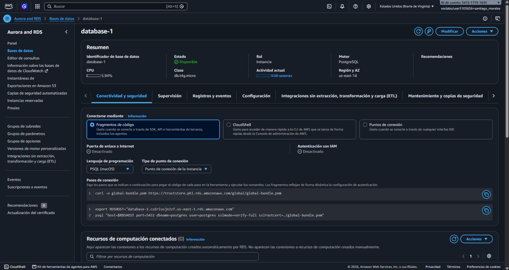

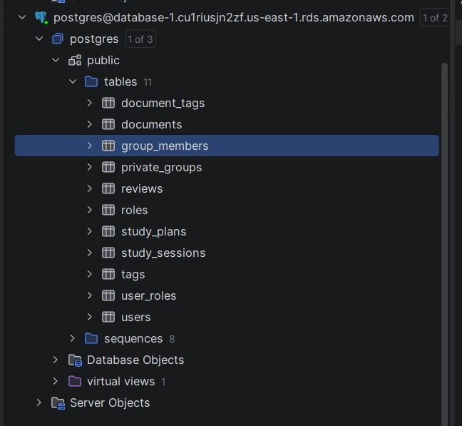

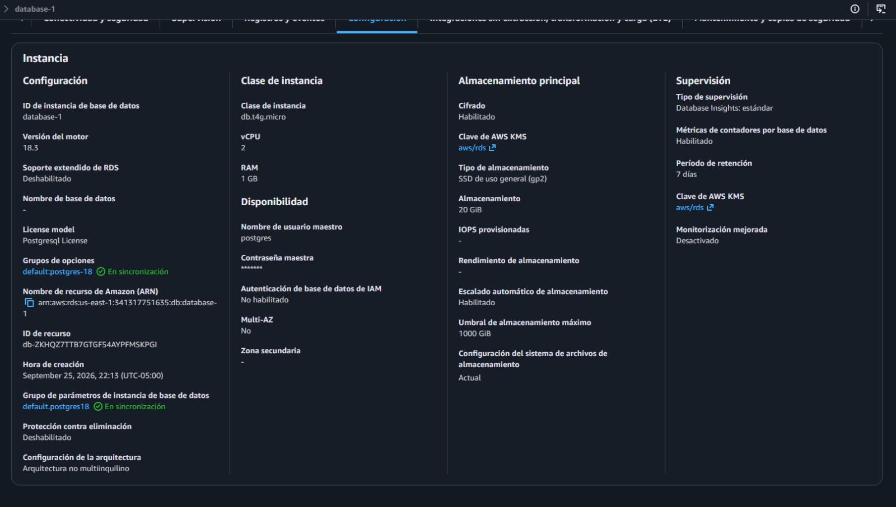

### Evidencias del Deploy en EC2 (AWS)

Muestra la instancia creada, la conexión SSH y la aplicación ejecutándose en un puerto de la instancia:

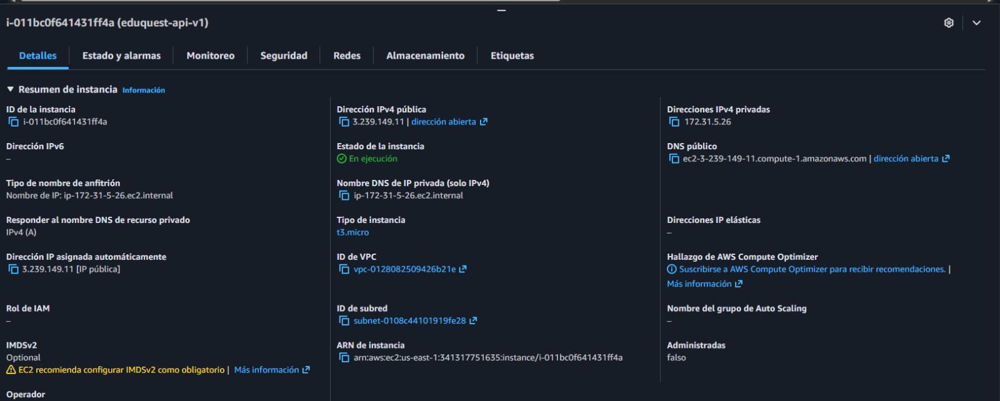

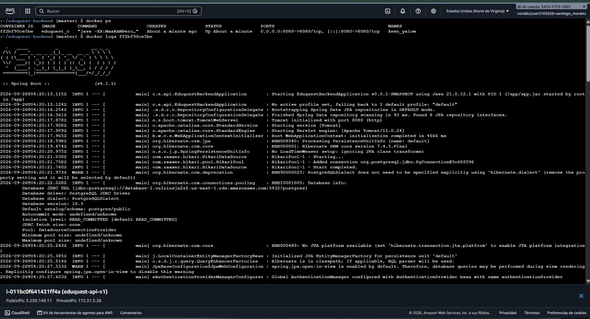


### Evidencias del Postman con el backend desplegado

Ejecución de la colección (`postman_collection.json`) contra la URL pública del backend desplegado:

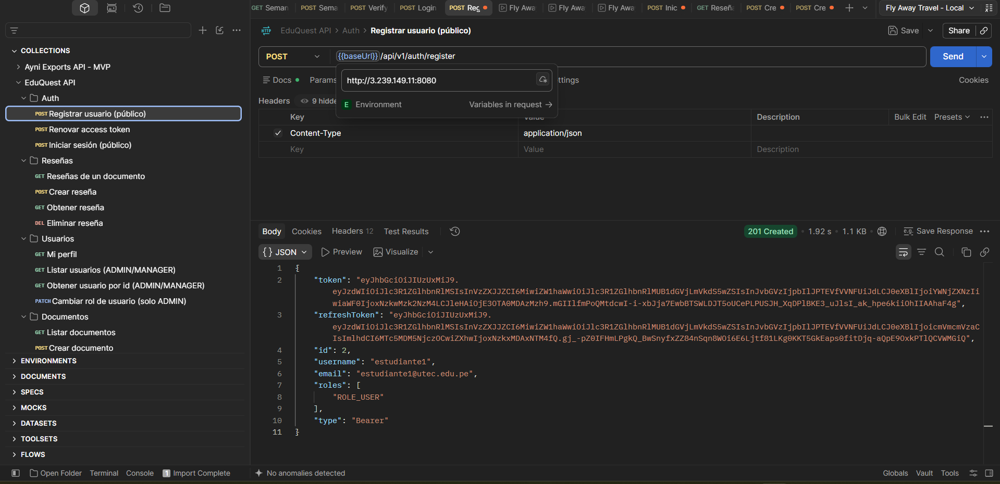


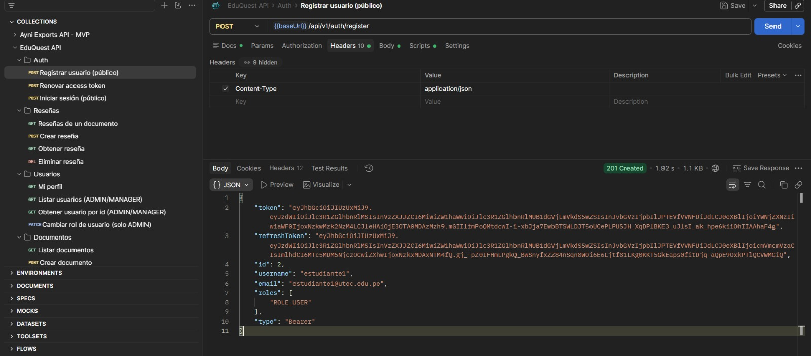

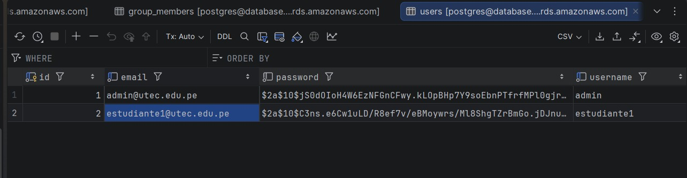


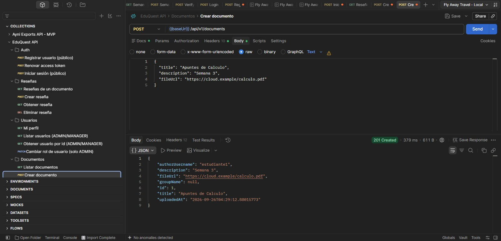

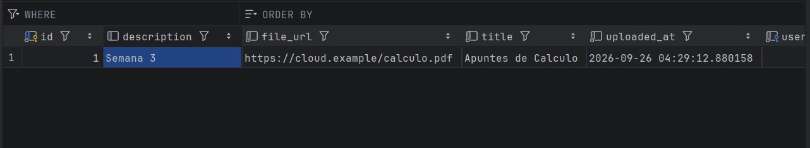


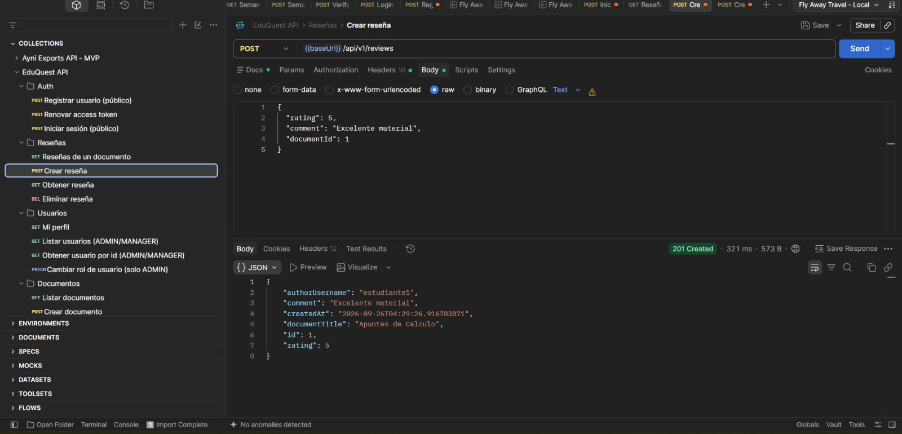

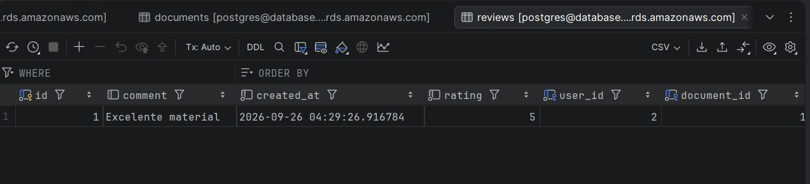

## GitHub & Management

El código vive en un repositorio central en GitHub con `main` como rama de integración y **GitHub Actions** como CI: el flujo compila, ejecuta los tests y valida la cobertura mínima del 80% con JaCoCo (`./mvnw verify`) en cada push. Los avances se registran en commits organizados por misión (seguridad, eventos, deployment) y, para la siguiente fase, la gestión del backlog se hará con GitHub Issues.

## Conclusión

### Logros del Proyecto

EduQuest entrega un backend completo en capas: modelo de 14 entidades con relaciones correctas, 38 DTOs segregados, autenticación JWT con refresh tokens y roles, manejo global de errores en formato ProblemDetail, tres eventos asíncronos con correos HTML, generador de planes de estudio basado en Google Gemini y documentación interactiva con Swagger, todo desplegable en la nube con un repositorio limpio y documentado.

### Aprendizajes Clave

El equipo consolidó patrones aprendidos en el curso: arquitectura Controller→Service→Repository, segregación de DTOs, seguridad Spring Security + JWT, eventos/transacciones con `@TransactionalEventListener`, y el manejo estandarizado de errores. El trabajo colaborativo en Git y la automatización con CI fueron fundamentales para mantener la calidad del código.

### Trabajo Futuro

- Upload de archivos directo a S3/Cloudinary, para no guardar videos pesados en la base de datos.
- Sala de voz propia (WebRTC) en lugar de abrir Jitsi Meet en otra pestaña.

